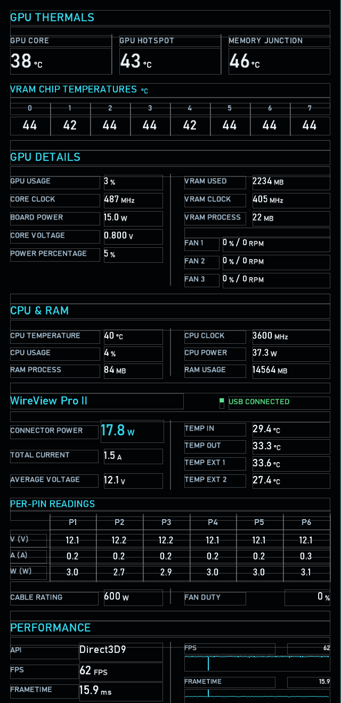
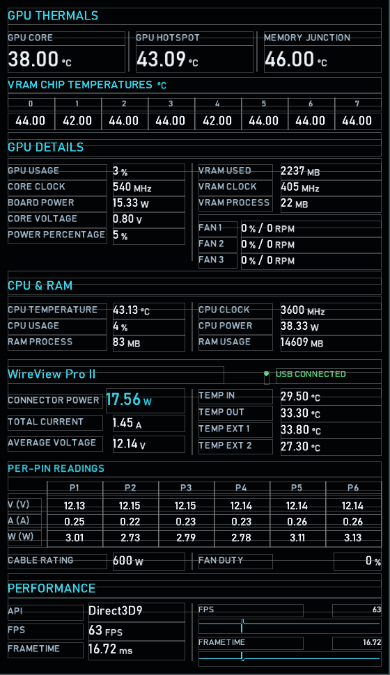
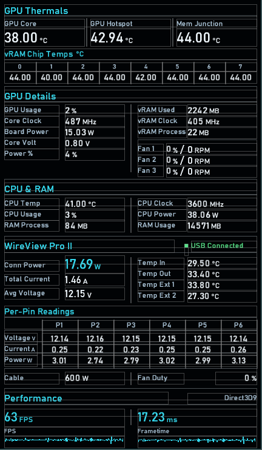
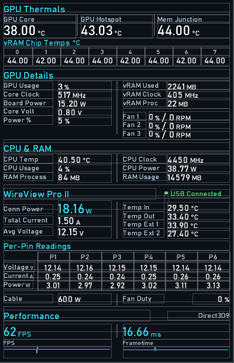
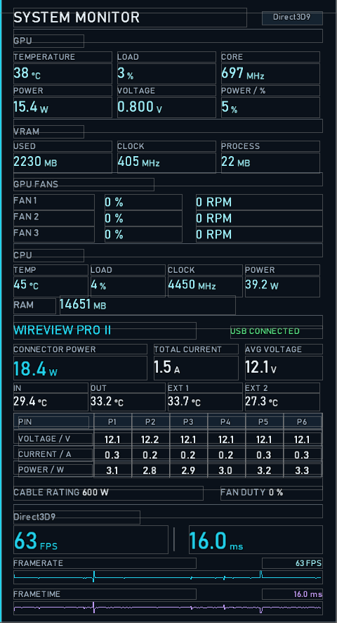
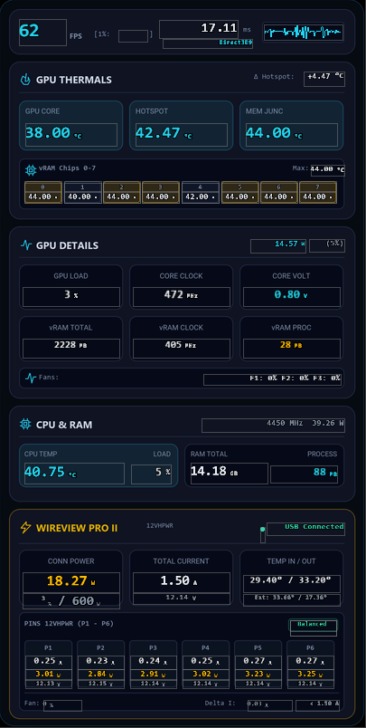

# RTSS Overlays for WireView Pro II

A collection of free, MIT-licensed overlay layouts for the RivaTuner
Statistics Server (RTSS) OverlayEditor plugin. Each layout shows GPU, CPU,
RAM, and framerate data together with the connector readings from a
WireView Pro II.

## Overlays

| Overlay | File | Size (px) | Notes |
| --- | --- | --- | --- |
| Thermal Glass - Large | `ThermalGlass_Large.ovl` | 640 × 1344 | All sections, 1 decimal |
| Thermal Glass - Medium | `ThermalGlass_Medium.ovl` | 560 × 970 | All sections, 2 decimals |
| Thermal Glass - Small | `ThermalGlass_Small.ovl` | 432 × 742 | Compact layout with VRAM chip temperatures |
| Thermal Glass - Mini Opaque | `ThermalGlass_Mini_Opaque.ovl` | 400 × 620 | Smallest layout, opaque background |
| System Monitor - WireView Pro II | `SystemMonitor_WireView.ovl` | 480 × 886 | Classic system monitor layout |
| Neon Dashboard | `NeonDashboard.ovl` + `NeonDashboard.png` | 405 × 804 | Card layout with a background image |

### Thermal Glass - Large



### Thermal Glass - Medium



### Thermal Glass - Small



### Thermal Glass - Mini Opaque



### System Monitor - WireView Pro II



### Neon Dashboard



## Requirements

All overlays need the following:

- **RivaTuner Statistics Server** with its **OverlayEditor** plugin enabled.
- **MSI Afterburner**, which provides all sensor data to the overlays.
- **[WireView Pro II for MSI Afterburner](https://github.com/VolterMort/WireViewPro2_MSIAB)**,
  my plugin that reads the WireView Pro II over USB. It provides the
  connector power, per-pin, temperature, fan, cable rating, and connection
  readings.
- **[HotSpot.dll v1.7](https://www.overclock.net/posts/29600087/)**, an
  Afterburner plugin that shows extra GPU temperature information, such as
  the memory junction temperature, individual temperatures for each VRAM
  chip, the hottest one, and the four temperature sensors on the GPU die
  itself.

The layouts use the Bahnschrift and Consolas fonts, which are included with
Windows 10 and 11.

The VRAM section shows eight chips (`VRAM chip 0` to `VRAM chip 7`). On GPUs
with a different number of VRAM chips, some fields may stay empty or some
chips may not be shown.

## Installation

1. Install and set up both Afterburner plugins by following their own
   instructions.
2. In MSI Afterburner, open **Settings > Monitoring** and enable the sensors
   used by the overlay in **Active hardware monitoring graphs**. The overlays
   read their data from Afterburner, so a disabled sensor shows no value.
   Enabling **Show in On-Screen Display** is not needed for these sensors.
3. Copy the `.ovl` file into the RTSS overlays folder:

   ```text
   C:\Program Files (x86)\RivaTuner Statistics Server\Plugins\Client\Overlays
   ```

   For **Neon Dashboard**, also copy `NeonDashboard.png` into the same
   folder. Without it, the overlay loses its background.
4. In RTSS, open **Setup > Plugins**, enable **OverlayEditor.dll**, and open
   its setup window.
5. Load the overlay layout you copied, then make sure RTSS is running and
   launch a game.

## License

These overlays are available under the [MIT License](LICENSE).

This is an unofficial project with no affiliation with Thermal Grizzly, MSI,
the author of RTSS, or the author of HotSpot.dll.
